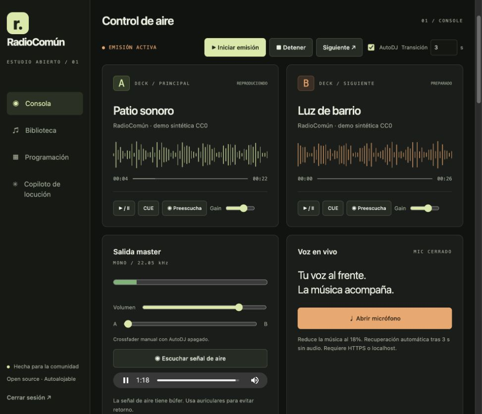

# RadioComún

**Una consola radial abierta, autoalojable y en español.** AutoDJ real en servidor, dos decks, programación semanal, jingles, voz en vivo y un copiloto de locución que separa fuentes, hechos revisados e interpretación.



Código MIT. Demo sonora original generada como tonos sintéticos, dedicada al dominio público bajo CC0. No incluye canciones comerciales, letras ni claves.

> Versión 1.0: base funcional para una emisora pequeña. No es una suite profesional de alta disponibilidad. La matriz de estado de abajo indica exactamente lo implementado y lo pendiente.

## Empezar en local

Requiere Python 3.11+; sin paquetes Python externos. Node solo sirve para verificar sintaxis del frontend. FFmpeg es opcional para la demo WAV y necesario para otros formatos.

```sh
git clone https://github.com/nicolasgalaguna-cyber/Dev.git radiocomun
cd radiocomun
python3 scripts/seed_demo.py
export RADIO_TOKEN="elige-una-clave-aleatoria-de-al-menos-16-caracteres"
python3 -m server.app
```

Abre **http://localhost:8080**, introduce la misma clave y pulsa **Iniciar emisión**, luego **Escuchar señal de aire**. La demo genera tres piezas instrumentales sintéticas cortas y dos jingles. No es una selección musical editorial.

El servidor inicia detenido por seguridad. Al cerrar el navegador, la emisión activa continúa. Tras reiniciar el proceso debes pulsar Iniciar emisión; listas, audio, parrilla, dossiers y guiones permanecen en SQLite y `data/media/`. La posición exacta de reproducción no se restaura.

Para importar sin FFmpeg usa WAV mono PCM16 a 22050 Hz. Con FFmpeg se aceptan los formatos que este decodifica, hasta 80 MB y 30 minutos por archivo. En esta versión se conserva todo el audio decodificado de cada deck en memoria; planifica unos 160 MB para dos programas de 30 minutos, además del proceso y los jingles.

## Docker

```sh
cp .env.example .env
# Edita .env y sustituye las tres claves de ejemplo por claves distintas y aleatorias.
docker compose up --build -d
docker compose exec radio python scripts/seed_demo.py --data /data
```

Abre http://localhost:8080. El volumen `station` conserva la biblioteca y SQLite. Para difusión MP3 mediante Icecast:

```sh
docker compose --profile broadcast up --build -d
```

Después de iniciar la emisión, escucha **http://localhost:8000/radio.mp3**. En este entorno no estaban instalados Docker ni FFmpeg: los contenedores y el puente se entregan configurados, pero su ejecución extremo a extremo requiere validación en el equipo de despliegue. CI instala FFmpeg y construye ambas imágenes.

Los puertos se publican solo en localhost. Para Internet configura tu propio proxy HTTPS (ver [operación](docs/OPERATIONS.md)). No cambies el enlace a 0.0.0.0 sin controles de acceso y TLS. La consola no se puede ejecutar en GitHub Pages.

## Qué funciona y qué falta

| Componente | Estado | Alcance y límites |
| --- | --- | --- |
| Consola web | Implementada | Responsive, español, acceso con clave, estado real del servidor cada 1.5 s |
| AutoDJ | Implementado y probado | Reloj del servidor, rotación secuencial de listas, dos decks, crossfade de potencia constante, salto, ganancia, master y saturación PCM acotada |
| Audio | Implementado y probado | PCM mono 22050 Hz; salida WAV continua pública; sin normalización EBU R128 ni ecualizador |
| Biblioteca | Implementada | Importar audio, preescuchar, rangos HTTP, clasificar música/jingle. No hay editor de tags, borrado ni deduplicación |
| Listas | Implementadas | Crear desde selección y activar lista base; API admite orden y repeticiones. No hay editor visual de reordenación |
| Parrilla | Implementada y probada | Bloques semanales, días, prioridad, zona horaria IANA, eliminación. Se aplica al preparar siguiente pista; puede haber una pista ya precargada |
| Dos decks | Implementados | Carga/play/cue/gain manual y crossfader con AutoDJ apagado; preescucha local independiente. Las ondas son decorativas, sin BPM ni beat sync |
| Jingles | Implementados y probados | Hasta cuatro simultáneos, mezclados en el servidor. Suenan con transporte activo |
| Micrófono | Backend y frontend implementados | AudioWorklet → PCM → servidor; concesión exclusiva por sesión de 3 s, ducking al 18%, retorno por caducidad; requiere HTTPS/localhost. Permiso y captura física no validados aquí |
| Takeover avanzado | Arquitectura pendiente | No hay WebRTC, SIP, entrada de estudio externo ni asignación física de auriculares |
| Copiloto investigador | Integración implementada; pruebas con proveedor simulado | OpenAI Responses + web_search, citas, fuentes, borrador persistente. Requiere API key y acceso al modelo; sin consulta de pago realizada aquí |
| Verificación | Implementada como proceso editorial | El editor aporta afirmación, tipo, enlace y nombre después de leer la fuente. No es comprobación automática ni identidad de editor autenticada por separado |
| Guiones | Implementados y probados | Generador local basado en metadatos y afirmaciones revisadas; duración orientativa, texto editable/copiable; sin TTS ni generación libre de IA |
| Historial | Implementado | Últimas 200 pistas completadas. No es registro regulatorio ni identifica jingles/micrófono |
| Docker + Icecast | Configurados; sin ejecutar localmente | Puente MP3 con reconexión; infraestructura de despliegue pendiente de prueba donde haya Docker |
| Landing GitHub Pages | Implementada | HTML/CSS estáticos en docs/ y workflow. Activación de Pages requiere configuración en GitHub |
| Usuarios y permisos | Pendiente | Una sola clave de estudio; sin cuentas, roles, auditoría por identidad ni SSO |
| Operación profesional | Pendiente | Reglas anti repetición, alertas de silencio, estéreo 48 kHz, almacenamiento remoto, backup automatizado y alta disponibilidad |

## Uso del estudio

1. **Biblioteca:** importa archivos con título y artista. Selecciona casillas y crea una lista.
2. **Consola:** elige lista base e inicia. El AutoDJ carga dos pistas y continúa sin navegador. Detener pausa el transporte; el micrófono puede seguir emitiendo hasta cerrarlo.
3. **Manual:** apaga AutoDJ, carga A/B desde la biblioteca, pulsa play y mueve el crossfader. El transporte master debe estar activo. CUE vuelve al inicio y pausa el deck.
4. **Preescucha:** reproduce la pista completa desde el inicio en el navegador; no modifica la señal de aire. No hay enrutamiento de dispositivos independiente: usa auriculares y un mezclador físico si necesitas cue separado.
5. **Jingles:** importa como jingle y dispara desde la cartuchera. Se suman a la mezcla, sin corte de música.
6. **Programación:** crea bloques y prioridades. Mayor prioridad gana; empates por inicio más reciente y luego id. Fin exclusivo. Divide medianoche en dos bloques. Una pista precargada puede sonar antes del cambio de bloque.
7. **Voz:** abre micrófono y concede permiso. Usa auriculares. La música sigue al 18%; se recupera al cerrar o perder la concesión. La latencia HTTP/búfer no sirve como retorno vocal en vivo.

## Copiloto con fuentes

Configura `OPENAI_API_KEY` solo en el servidor, y opcionalmente `OPENAI_MODEL` (predeterminado `gpt-6-astra`). El modelo debe permitir Responses y `web_search` en tu cuenta. Las consultas tienen costo; se limita a una simultánea y una cada 15 segundos por estación.

La investigación distingue identidad de canción, artista, contexto, declaraciones e interpretaciones; solicita fuentes primarias y evita reproducir letras. Muestra el texto y los enlaces de las anotaciones de la respuesta. Las citas **no verifican automáticamente** los hechos. El editor debe abrir la fuente, confirmar identidad/versiones, contrastar el contenido y registrar cada afirmación con su tipo y enlace. Solo esas afirmaciones se incorporan al guion local; las interpretaciones se anuncian como posibles lecturas.

Sin clave API, funciona el resto de la estación y puedes introducir investigación manual contrastada. Los metadatos subidos no se verifican automáticamente. No introduzcas letras completas ni atribuyas inspiración sin fuente. Ver [política editorial](docs/EDITORIAL.md).

## Verificación

```sh
python3 -m unittest discover -s tests -v
node --check public/app.js
node --check public/mic-worklet.js
```

Las pruebas cubren mezcla, avance de decks, límites PCM, rotación, prioridades, persistencia, sesión, acceso a rutas, carga de audio, rangos, jingles, salida continua, micrófono, caducidad y citas simuladas. La prueba MP3 se omite si falta FFmpeg. El workflow CI añade FFmpeg, verifica Compose y construye ambas imágenes; su resultado debe consultarse en Actions tras publicar.

## Publicar y GitHub Pages

El repositorio está preparado para `nicolasgalaguna-cyber/Dev`. Si trabajas desde una copia sin remoto:

```sh
git init -b main
git add .
git commit -m "Build RadioComun community radio station"
git remote add origin https://github.com/nicolasgalaguna-cyber/Dev.git
git push -u origin main
```

Si el remoto ya contiene trabajo, clónalo y copia los archivos dentro; no uses push forzado. `.gitignore` excluye secretos y datos de emisora.

Para la landing: en GitHub abre **Settings → Pages → Build and deployment → Source → GitHub Actions**. Ejecuta **Actions → Publish project landing page → Run workflow**. Con despliegue exitoso la dirección prevista es `https://nicolasgalaguna-cyber.github.io/Dev/`. No se debe anunciar como publicada hasta que Actions confirme el despliegue. Alternativa sin workflow: **Deploy from a branch → main → /docs**.

La landing enlaza la documentación. No es una demo conectada a tu servidor privado y no almacena secretos. El backend y audio requieren un servidor propio.

## Estructura

- `server/`: HTTP, SQLite, motor PCM y copiloto.
- `public/`: consola sin framework y captura AudioWorklet.
- `scripts/`: demo, puente de streaming y configuración Icecast.
- `docs/`: landing de Pages, arquitectura, operación, API y política editorial.
- `tests/`: pruebas unitarias e integración HTTP con stdlib.

Lee [arquitectura](docs/ARCHITECTURE.md), [operación y backup](docs/OPERATIONS.md), [API](docs/API.md), [seguridad](SECURITY.md) y [contribución](CONTRIBUTING.md).
